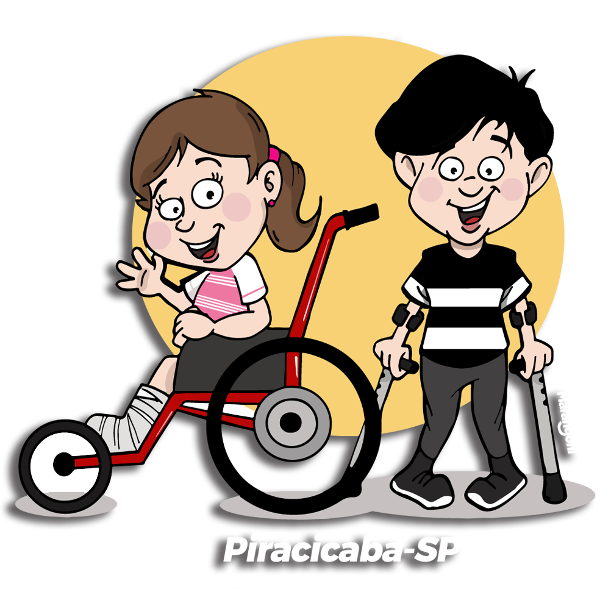
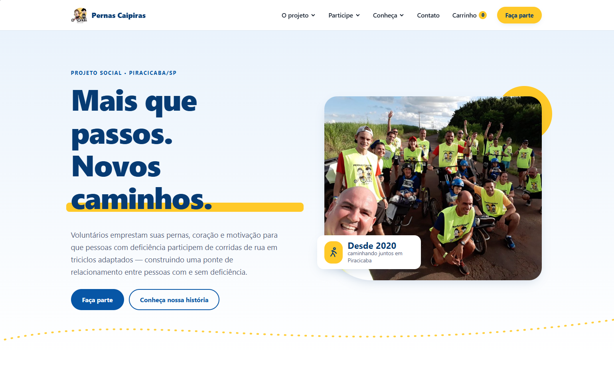
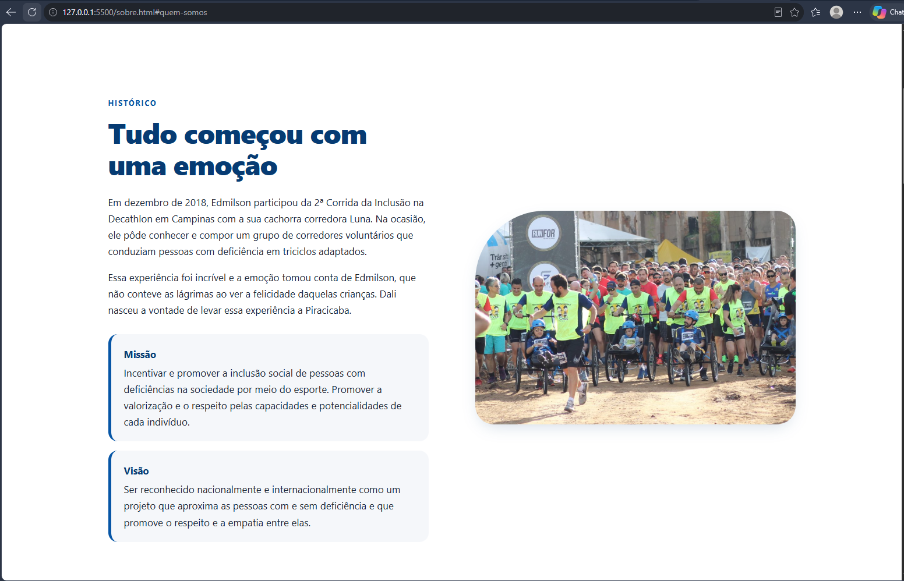
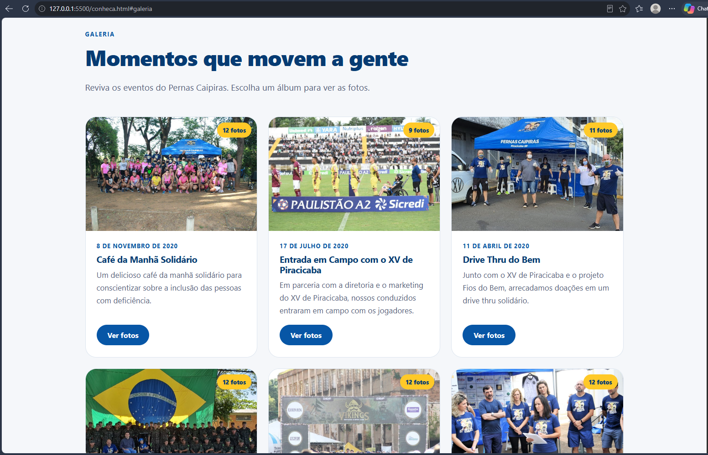
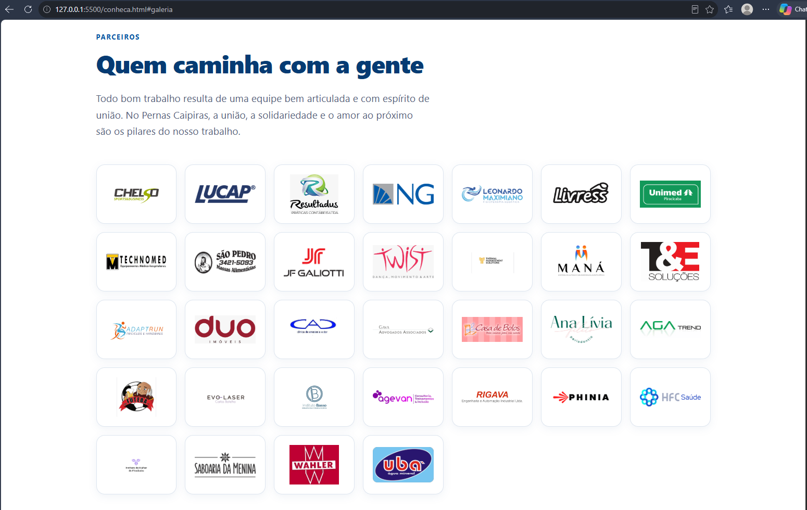
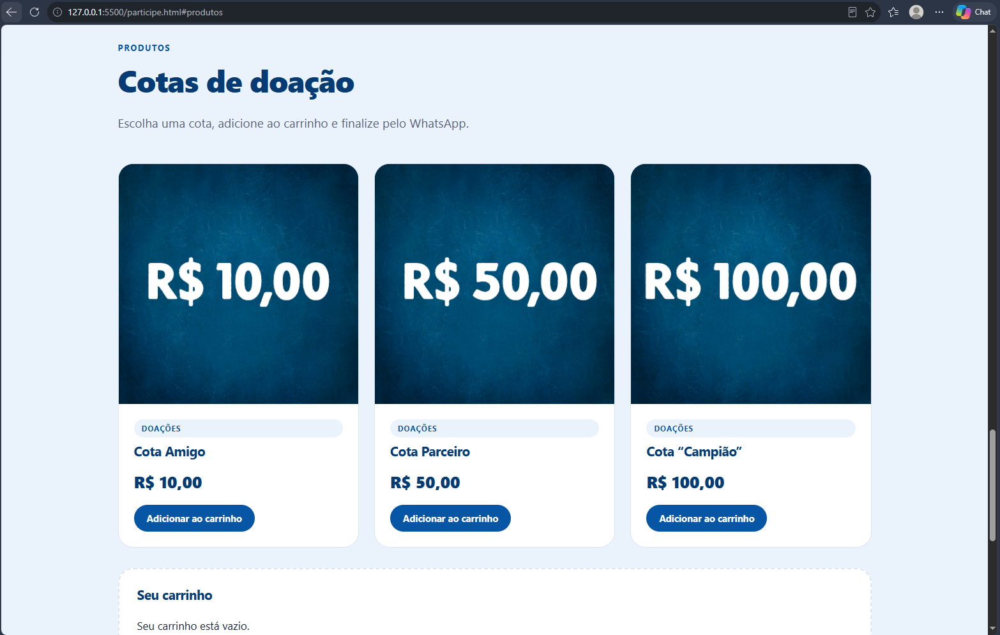
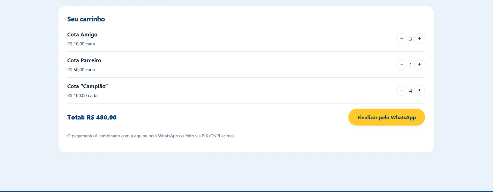
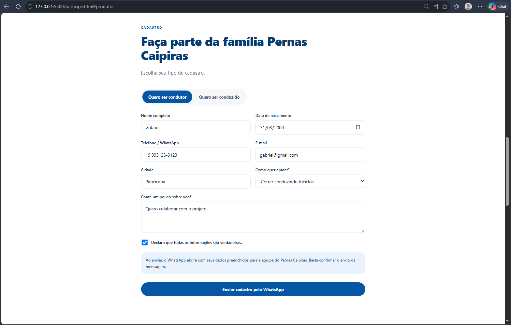
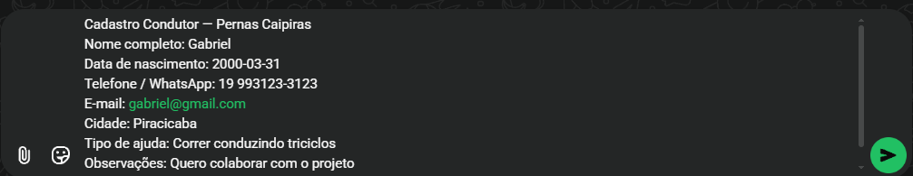

# Projeto Interdisciplinar de Computação I (Faculdade de Engenharia de Piracicaba)

<p align="center">
  
</p>

# Pernas Caipiras — Site Institucional

> **Projeto Interdisciplinar** · *Juntos fazemos a diferença*

## Objetivo do projeto

O **Pernas Caipiras** é um projeto social de Piracicaba/SP que leva pessoas com deficiência às corridas de rua em **triciclos adaptados**, conduzidos por voluntários.

Este repositório tem o **site institucional** do projeto. Os objetivos são:

- divulgar a história, o propósito e o impacto do projeto;
- atrair **voluntários (condutores)** e cadastrar **conduzidos**;
- facilitar **doações** (PIX e cotas de doação);
- mostrar os eventos na galeria e dar visibilidade aos **parceiros**;
- oferecer um canal de contato direto pelo WhatsApp.

## Integrantes do grupo

| Nome |
|------|
| Gabriel Calderan Reame |
| Gabriel Henrique Barbosa Modica |

## Tecnologias utilizadas

- **HTML5**: estrutura semântica e acessível das páginas (`header`, `nav`, `main`, `section`, ARIA, link "Pular para o conteúdo").
- **CSS3**: estilização e layout responsivo em um único arquivo, `style.css`.
- **JavaScript (ES5, puro, sem frameworks)**: interatividade em `js/main.js`.
- **Web Storage API (`localStorage`)**: guarda o carrinho de cotas de doação.
- **Clipboard API**: copia a chave PIX com um clique.
- **WhatsApp (wa.me)**: recebe os formulários e os pedidos de doação.

## Requisitos e dependências

O site é **estático**. Ele não precisa de banco de dados, servidor de aplicação nem instalação de pacotes.

| Requisito | Obrigatório? | Observação |
|-----------|--------------|------------|
| Navegador moderno (Chrome, Edge, Firefox, Safari) | Sim | Precisa ter JavaScript habilitado |
| Conexão com a internet | Parcial | Necessária apenas para enviar mensagens pelo WhatsApp |
| Git | Opcional | Usado para clonar o repositório |
| Servidor local (VS Code Live Server) | Opcional | Recomendado para testar como em produção |
| Editor de código (VS Code) | Opcional | Usado para editar o projeto |

### Instalação, configuração e execução

### 1. Obter os arquivos

Clone o repositório ou baixe os arquivos do projeto e extraia-os para uma pasta em seu computador.

```bash
git clone https://github.com/gabrielreame2007-creator/PROJETO-INTERDISCIPLINAR-DE-COMPUTA-O-I---EEP---PC.git
```

Entre na pasta do projeto:

```bash
cd PROJETO-INTERDISCIPLINAR-DE-COMPUTA-O-I---EEP---PC
```

Se o repositório já tiver sido baixado como ZIP, basta extrair a pasta e abri-la no editor de código.

### 2. Abrir no Visual Studio Code

Abra a pasta do projeto no Visual Studio Code. Para uma execução simples, instale a extensão **Live Server**, abra o arquivo `index.html` e clique em **Go Live**.

### 3. Executar sem servidor (alternativa)

Também é possível abrir o arquivo `index.html` diretamente no navegador. Entretanto, recomenda-se utilizar um servidor local para manter um ambiente de execução mais próximo ao de hospedagem.

### 4. Configuração

Não há processo de compilação ou instalação de pacotes. Para personalizar o projeto:

- Edite os arquivos `.html` para alterar o conteúdo das páginas.
- Edite `style.css` para modificar cores, espaçamentos, layout e responsividade.
- Edite `js/main.js` para modificar as interações e comportamentos.
- Adicione ou substitua imagens na pasta `assets/`, mantendo os caminhos utilizados no HTML.


## Principais funcionalidades

- **Página inicial (`index.html`)**: apresenta o projeto, as formas de ajudar, o impacto, as novidades e o contato.
- **O projeto (`sobre.html`)**: reúne *Quem somos*, *Propósito*, *Sobre a deficiência* e *Nossa história* (linha do tempo).
- **Participe (`participe.html`)**:
  - Formulários de **cadastro de Condutor** e de **Conduzido**, com validação. Ao enviar, a mensagem preenchida é aberta no WhatsApp.
  - **Doação via PIX**, com botão para copiar a chave (CNPJ 41.045.474/0001-37).
  - **Carrinho de cotas de doação**: permite adicionar e remover cotas, calcula o total em R$ e salva o carrinho no `localStorage`. O pedido é finalizado pelo WhatsApp.
- **Galeria e parceiros (`conheca.html`)**: mostra as fotos por evento em **abas acessíveis** (Lançamento, Drive-thru, Café Solidário, Tiro de Guerra, Vikings e XV de Piracicaba) e a vitrine das empresas parceiras.
- **Contato (`contato.html`)**: lista os canais de atendimento e tem um formulário que envia a mensagem pelo WhatsApp.
- **Menu de navegação com submenus**, que funciona sem JavaScript (`<details>`).
- **Layout responsivo** para celular, tablet e desktop.
- **Acessibilidade**: HTML semântico, atributos ARIA, navegação por teclado e textos alternativos nas imagens.
- **Ano automático** no rodapé.

## Estrutura de pastas

```
├── index.html          # Página inicial
├── sobre.html          # O projeto
├── participe.html      # Como ajudar, cadastros e doações
├── conheca.html        # Galeria e parceiros
├── contato.html        # Fale conosco
├── style.css           # Estilos do site
├── js/
│   └── main.js         # Abas, formulários, PIX e carrinho
└── assets/
    ├── logo.png, favicon.png, imagens gerais
    ├── doacoes/        # Imagens das cotas (R$10, R$50, R$100)
    ├── galeria/        # Fotos dos eventos, em subpastas
    └── parceiros/      # Logos dos parceiros
    └── prints/         # Prints 
```

## Imagens e exemplos de funcionamento

| Tela Inicial | Home |
|---|---|
|  |  |

| Galeria | Parceiros |
|---|---|
|  |  |

| Cotas | Carrinho |
|---|---|
|  |  |

| Formulário | WhatsApp |
|---|---|
|  |  |

### Exemplo: cadastro de condutor
1. Acesse **Participe → Cadastro** e preencha o formulário.
2. Clique em **Enviar**. O WhatsApp abre com a mensagem pronta:
   ```
   Cadastro Condutor — Pernas Caipiras
   Nome: Maria Silva
   Telefone: (19) 90000-0000
   ✔ Li e concordo com os termos
   ```

### Exemplo: carrinho de cotas
1. Clique em **Adicionar ao carrinho** nas cotas desejadas.
2. Ajuste as quantidades com os botões **−** e **+**. O total é recalculado na hora.
3. Clique em **Finalizar**. O WhatsApp abre com o resumo:
   ```
   Olá! Quero colaborar com o Pernas Caipiras:
   2x Cota R$ 50 (R$ 50,00)
   Total: R$ 100,00
   ```

### Responsavel pelo repositório e reame.md:
| Nome |
|------|
| Gabriel Calderan Reame |

---
<sub>Projeto desenvolvido para fins acadêmicos (Projeto Interdisciplinar).</sub>
